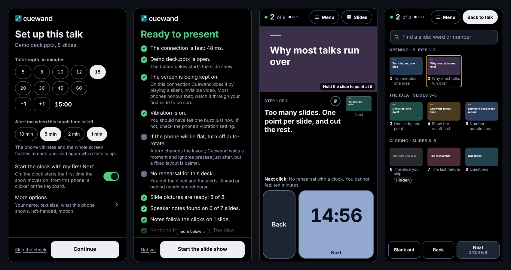
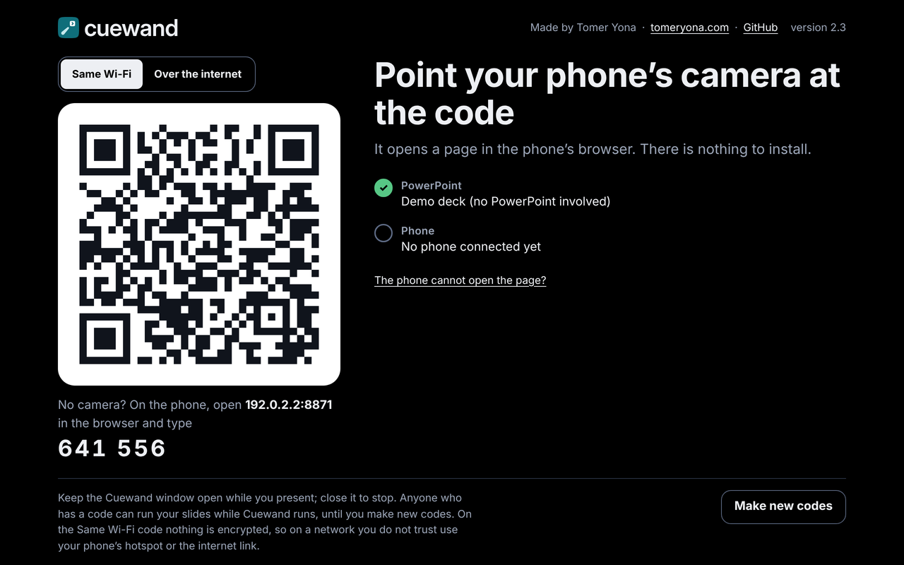

<p align="center">
  <picture>
    <source media="(prefers-color-scheme: dark)" srcset="logo/cuewand-lockup-on-dark.png">
    
  </picture>
</p>

<p align="center"><b>Your phone becomes the remote for PowerPoint.</b><br>
Next and Back, your speaker notes, the clock, and a laser pointer.<br>
Nothing is installed on the phone: it scans a code and a web page opens.</p>

<p align="center"></p>

## What it does

- **One big Next button that is also your clock.** Its fill is the time left; it turns amber when time runs short, and the phone vibrates and flashes at the alerts you chose.
- **Your speaker notes, step by step.** Write `[click]` in your notes where an animation step starts, and the phone shows only what to say now.
- **A laser pointer.** Hold the slide picture on the phone to point at the screen.
- **Questions.** Find any slide by a word or its number, jump to it, and come back with one tap.
- **Rehearsal and pace.** Time one run-through; during the talk Cuewand tells you if you are ahead or behind.
- **Co-presenters.** Several phones can connect; one can have the slides while the others follow.
- **Your clicker still works.** A press on the clicker shows up on the phone, and the clock starts with the first advance whichever of them made it.

<p align="center"></p>

## What you need

- A **Windows laptop with PowerPoint** (it has run on Windows 11 with PowerPoint 16). There is no Mac version.
- **Nothing else**, if you download **Cuewand-for-Windows.zip** from [Releases](https://github.com/TomerIL/cuewand/releases/latest): it carries its own Python. (Running from the source code instead needs Python 3.8 or newer from [python.org](https://www.python.org/downloads/); on its first start Cuewand then installs pywin32, which is what talks to PowerPoint.)
- **A phone with a browser** on the same Wi-Fi as the laptop, or the phone's own hotspot, or the optional internet link.

## Start

1. Download **Cuewand-for-Windows.zip** from [Releases](https://github.com/TomerIL/cuewand/releases/latest) and extract it (right-click, Extract All).
2. Double-click **Start Cuewand.bat**. A page opens in your browser with a large code.
3. Open your deck in PowerPoint and scan the code with the phone's camera.
4. On the phone, Setup asks for the talk length and the alerts. One tap runs a ready check; the button under its answer starts the slide show.

**Windows firewall:** when Windows asks about Python, tick **Public as well as Private**, then Allow. Hotel, venue and hotspot networks count as Public.

**Before an important talk**, open your deck and double-click **Test Cuewand.bat**: it presses through the whole deck and checks that every press landed exactly once.

The full manual, with every screen, option and what to do when something goes wrong, is [README.txt](README.txt).

## Try it without PowerPoint

```
python cuewand.py --demo
```

runs Cuewand with a built-in demo deck, on any computer.

## Privacy

Nothing is sent to the author, and there are no accounts, analytics or tracking. Your notes, slide pictures and presses travel only between the laptop and your phone. The optional internet link relays them, encrypted, through Cloudflare's free quick tunnels. Logs, codes and rehearsal times stay in the Cuewand folder on the laptop. Details: [README.txt](README.txt), "What Cuewand sends, and to whom".

The pairing page and its buttons answer only the laptop itself. On "Same Wi-Fi" the traffic is not encrypted, so on a network you do not trust, use your phone's hotspot or the internet link.

## Status

Earlier versions ran on real PowerPoint 16 on Windows 11 with one presenter. Every change since has been tested against a stand-in for PowerPoint and in phone- and tablet-sized browsers: 598 automated checks in `tests/`, plus an accessibility audit of every screen. A stand-in cannot disagree with its author about how PowerPoint behaves, so run **Test Cuewand.bat** on your own deck. [README.txt](README.txt) lists exactly what has and has not been tried.

```
python tests/run_all.py
```

runs the checks on any computer (the two browser test files need [Playwright](https://playwright.dev/python/)).

## Credits

Made by [Tomer Yona](https://www.tomeryona.com). Built with Claude, Anthropic's AI model.

The pairing codes are drawn by [segno](https://github.com/heuer/segno) (BSD licence), which travels in `_vendor/`. Cuewand-for-Windows.zip carries [Python](https://www.python.org) and [pywin32](https://github.com/mhammond/pywin32) (both PSF licence); running from source installs pywin32 from PyPI. [cloudflared](https://github.com/cloudflare/cloudflared) (Apache 2.0) is downloaded only when you ask for the internet link.

Cuewand is not affiliated with or endorsed by Microsoft, Apple, Google or Cloudflare. PowerPoint and Windows are trademarks of Microsoft.

## Licence

[MIT](LICENSE).
